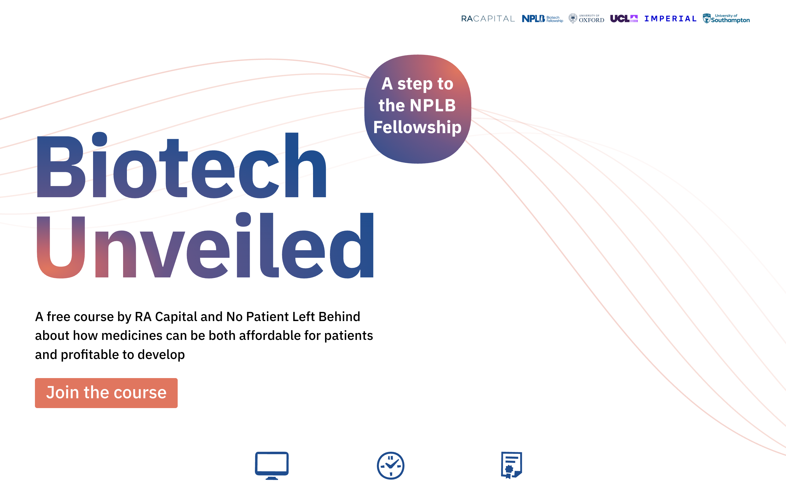

# Biotech Unveiled

Landing page for **[Biotech Unveiled](https://biotechunveiled.co.uk)**, a free 10-hour online course on how the biotech industry works (innovation, investment, drug development, market access and healthcare policy). The course is run by No Patient Left Behind and RA Capital.



## Stack

- **[Astro 6](https://astro.build)**: static output, with no JavaScript shipped by default
- **[Preact](https://preactjs.com)**: hydrates only the one interactive island (the transcript accordion)
- **[Tailwind CSS 4](https://tailwindcss.com)**: through the Vite plugin
- **Cloudflare Workers** (static assets): deployed with Wrangler to a custom domain
- **[Umami](https://umami.is)**: privacy-friendly analytics, with custom events on key CTAs

## Highlights

- **Mobile-first and responsive.** Separate layouts for phones, tablets and desktops, including decorative SVG spirals and "blob" art positioned for each breakpoint.
- **Content managed through env variables.** The fellowship application deadline is set with `PUBLIC_COURSE_DEADLINE` and validated through Astro's typed `astro:env` schema. Every date on the page comes from that one value, and the deadline text is hidden when the value is missing or invalid. Updating the deadline only takes a new deploy, with no code change.
- **SEO.** Canonical URL, Open Graph and Twitter cards, a generated sitemap, and `schema.org` JSON-LD describing the course and the organisations behind it.
- **Fonts loaded by Astro.** IBM Plex Sans and Inter come through Astro's Fontsource font provider, so there are no Google Fonts requests at runtime.
- **Accessible transcript.** The embedded video has a full text transcript in a collapsible section.

## Project structure

```text
src/
├── components/
│   ├── atoms/        # Link, Callout, Accordion (Preact island)
│   ├── molecules/    # Partners logo strip
│   └── main/         # Page sections: Hero, WhatToLearn, WhatToGet, WhomFor, Video, Qa, Cta, Footer
├── layouts/          # Base layout: meta tags, fonts, analytics
├── pages/index.astro # Single-page composition
├── utils/            # Date validation and formatting
└── styles/global.css # Tailwind theme tokens
```

## Running locally

Requires Node ≥ 22.12 and pnpm.

```sh
cp .env.example .env   # set PUBLIC_COURSE_DEADLINE (YYYY-MM-DD) and PUBLIC_UMAMI_WEBSITE_ID
pnpm install
pnpm dev               # http://localhost:4321
```

| Command        | Action                             |
| -------------- | ---------------------------------- |
| `pnpm dev`     | Start the dev server               |
| `pnpm build`   | Build the static site to `./dist/` |
| `pnpm preview` | Preview the production build       |

## Deployment

```sh
pnpm build && npx wrangler deploy
```

## Credits

Design by [Alina Kravchenko](https://bureau.ru/burosfera/alina-kravchenko) and development by [Georgy Mishurovskiy](https://www.linkedin.com/in/gamishurovsky/).
Course content, video and partner logos © their respective owners. They are included here only to show the live site.
